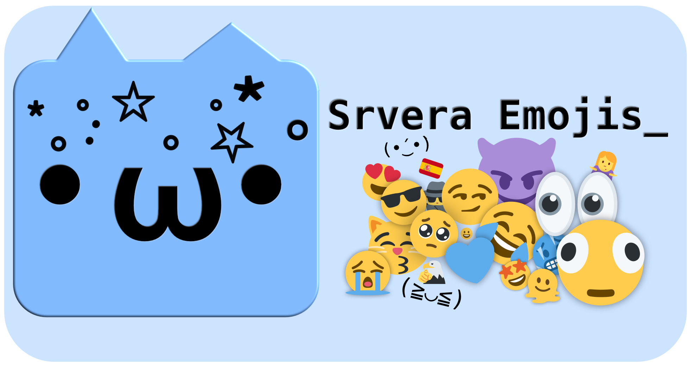
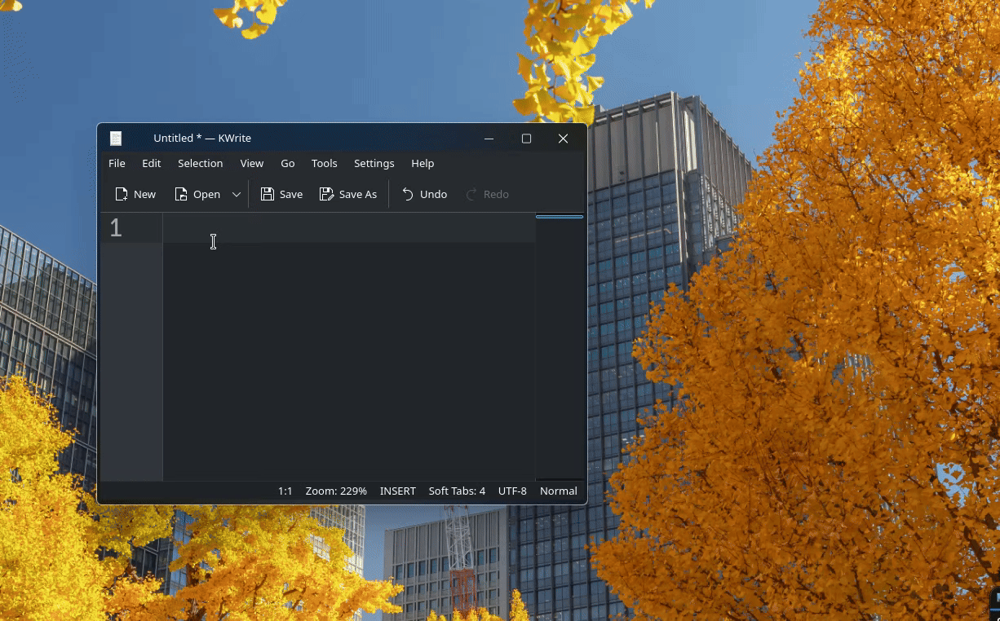
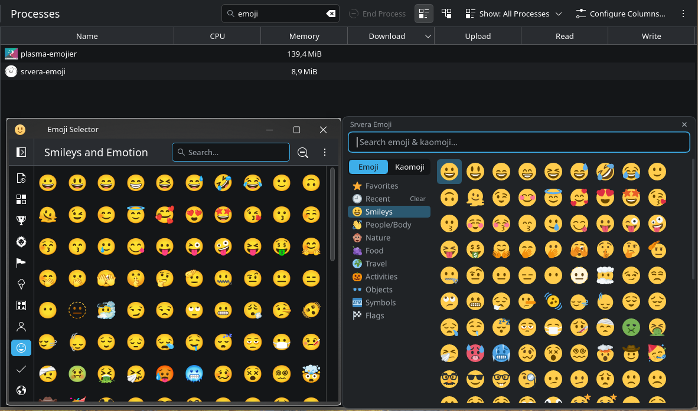
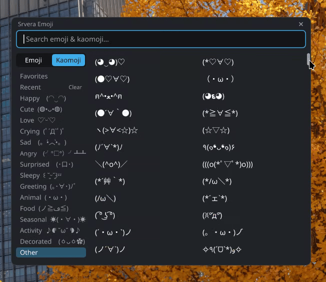

<p align="center">
  
</p>

# SrveraEmojis - Emoji/Kaomoji selector for Wayland (｀・ω・´)

A ultra-lightweight background Emoji & Kaomoji picker for Wayland, built in pure Rust ( ˶ˆ꒳ˆ˵ ).
<p align="left">
  
</p>

- Press (Super + .) anywhere, pick an Emoji or Kaomoji, and it is pasted right into the app you were typing in (*ﾉωﾉ).
- Built and tested on KDE Plasma 6. **DOES NOT WORK ON GNOME**

## Features
### No manual copy-pasting Σ(･ω･ﾉ)ﾉ
- Click an Emoji or Kaomoji and it's pasted straight into the app you were typing in
- Whatever text you had copied is put back right after, so your clipboard stays intact, *splendid*
- Picked Emojis & Kaomojis don't clutter *Klipper's* clipboard history either

### Doesn't steal your window's focus ( ˘ω˘ )
- The popup opens without taking over your keyboard, so the app you're typing in stays in focus
- Built on Wayland's layer-shell, so it shows up on top of all windows, even fullscreen games and videos

### Instantaneous at any time
- Do you still use HDDs in the big 2026? Tired of KDE-Emojier taking several seconds to launch?
- Then today's your lucky day (´・∀・｀)!
- I built Srvera emojis to open up in an instant, no matter if you were using a RAM heavy program beforehand or if your disk usage was overloaded (*≧▽≦)

 https://github.com/user-attachments/assets/ddc6d579-e0f9-403f-b3eb-562c7f127acb

### RAM usage (≧◡≦)
- With the RAM prices of today, I consider that having a emoji picker gobble up 50-150MBs of RAM is ***preposterous***
- Fortunately this picker only utilizes 3-7MBs idle and 9-15 with the popup open (ﾟﾛﾟ)
<p align="left">
  
</p>
The usage mentioned was for Pss

### Over 55k Kaomojis
Yes, you heard that right, so many expressions (◍•ᴗ•◍)♡
<p align="left">
  
</p>

## Installation

### Debian, Kubuntu, KDE neon, Mint (.deb)
```bash
sudo apt install ./srvera-emoji_0.18.0-1_amd64.deb
```

### Fedora KDE (.rpm)
```bash
sudo dnf install ./srvera-emoji-0.18.0-1.x86_64.rpm
```

### Any other distro (.tar.gz)
```bash
tar xzf srvera-emoji-0.18.0-x86_64.tar.gz
cd srvera-emoji-0.18.0-x86_64
./install.sh
```
It installs to your home folder and only asks for sudo once, to let the picker type the paste key.
Run `./uninstall.sh` from the same folder to remove it.

### I use arch btw 🤓☝️, CachyOS, EndeavorOS, Manjaro (AUR)
```bash
Coming soon until new account sign ups are enabled (｡•́︿•̀｡)
```

### After installing
- Plasma's own Emoji Selector also uses (Super + .). Give one of them another key in
  System Settings → Shortcuts. The picker's entry there is called "Srvera Emoji".
- On desktops other than KDE, bind a key to `srvera-emoji --toggle` yourself, for example in Sway:
  `bindsym $mod+period exec srvera-emoji --toggle`.

## Building from source
1. Clone from source:
   ```bash
   git clone https://github.com/ServeraServera/SrveraEmojis.git
   ```
2. Switch to the crate folder:
   ```bash
   cd SrveraEmojis/main
   ```
3. Install Rust (`cargo`), then build from `main/`:
   ```bash
   cargo build --release
   ```
4. Install the binary:
   ```bash
   install -Dm755 target/release/srvera-emoji ~/.local/bin/srvera-emoji
   ```
5. Let it type the paste key (once, needs root). Many systems already have this rule:
   ```bash
   echo 'KERNEL=="uinput", TAG+="uaccess"' | sudo tee /etc/udev/rules.d/60-srvera-uinput.rules
   ```
   Then reboot. Without it, picks are only copied to the clipboard.
6. Start it at login: add `~/.local/bin/srvera-emoji` in System Settings → Autostart, then
   start it once now with `srvera-emoji &`.
7. Plasma's own Emoji Selector also uses (Super + .). Give one of them another key in
   System Settings -> Shortcuts. The picker prints a warning naming the other shortcut if
   the key is taken.

On other desktops, bind a key to `srvera-emoji --toggle` yourself.

## Architecture
Srvera Emoji is a single Rust binary with no GUI toolkit. Everything it shows is drawn by
hand, and everything it needs is compiled into the binary.

### A background daemon (｡•̀ᴗ-)✧
- `srvera-emoji` starts hidden at login and waits. Opening the picker never starts a new
  process: (Super + .) is registered with KDE's shortcut service (kglobalaccel) over D-Bus,
  and each press arrives as a signal to the running daemon (~25 ms to open, even after
  long idle).
- The D-Bus client is ~340 lines written for this purpose instead of a full D-Bus crate.
- `srvera-emoji --toggle`, `--show` and `--quit` talk to the daemon through a Unix socket
  in `$XDG_RUNTIME_DIR`. This is how other desktops and scripts open it.

### Data built in at compile time
- `build.rs` reads `emoji-test.txt` (Unicode's emoji list), `kaomojis-msime.txt` and the
  Twemoji SVGs, and packs them into three compact tables embedded in the binary.
- Each emoji and kaomoji belongs to exactly one tab, decided at build time: emojis by their
  Unicode group, kaomojis by the first word of their keyword. Opening a tab simply shows its
  pre-sorted slice, and search is a separate keyword lookup.
- Each SVG is compressed on its own and only decompressed when that emoji is on screen.

### A layer-shell popup 
- The window is a Wayland layer-shell overlay, so it stays above fullscreen apps. It opens
  without keyboard focus so the app you're typing in keeps it. Clicking the search box takes
  the keyboard; picking something gives it back.
- KWin can't move layer surfaces, so dragging the title bar changes the window's margins instead.

### Drawing by hand 
- The UI is drawn with *tiny-skia* into a shared-memory buffer: rounded rectangles, text and
  images. Only visible rows are drawn, and a new frame is drawn only when the compositor
  asks for one.
- Emojis are always Twemoji, rendered with resvg at their exact on-screen size and briefly
  cached. This includes emojis inside kaomojis, e.g. `(*´∀｀)ﾉ🎂`.
- Kaomoji text is shaped with rustybuzz and its glyph outlines are filled directly. At
  startup the daemon finds the right installed font for every character used by the 55k
  kaomojis, in one pass, so scrolling never searches through fonts.
- HiDPI and fractional scaling are supported (`wp_fractional_scale` + `wp_viewporter`).

### Pasting without touching your clipboard
1. The text currently on your clipboard is read and kept aside.
2. The pick is offered as the clipboard (via `ext-data-control`), marked with
   `x-kde-passwordManagerHint: secret` so Klipper doesn't record it. *(The popup "The clipboard currently holds a sensitive piece of data that will not be stored in the history." might appear)*
3. Shift + Insert is sent through a virtual keyboard (`/dev/uinput`), which pastes into the
   focused app, terminals included.
4. Half a second later, your previous clipboard text is put back.

### Staying light 
- Fonts are memory-mapped, not loaded, and everything only needed while the window is open
  (pixel buffers, glyph faces, emoji images) is freed when it closes.
- Favorites and recents are two small text files in `~/.local/share/srvera-emoji/`.

### Source layout
| File | Role |
|---|---|
| `main/build.rs` | Packs the emoji/kaomoji lists and SVGs into the binary |
| `main/src/main.rs` | Command line and single-instance daemon |
| `main/src/app.rs` | Wayland: window, input, scaling, frame timing, event loop |
| `main/src/ui.rs` | Layout, drawing and interaction (knows nothing about Wayland) |
| `main/src/data.rs` | Access to the embedded tables and keyword search |
| `main/src/text.rs` | Font fallback, shaping and glyph drawing |
| `main/src/emoji_img.rs` | Twemoji SVG decoding and rendering |
| `main/src/paste.rs` | Clipboard handling and the virtual keyboard |
| `main/src/shortcut.rs` | Super+. through KDE's kglobalaccel (minimal D-Bus client) |

Don't mind me ( ͡° ͜ʖ ͡°)
